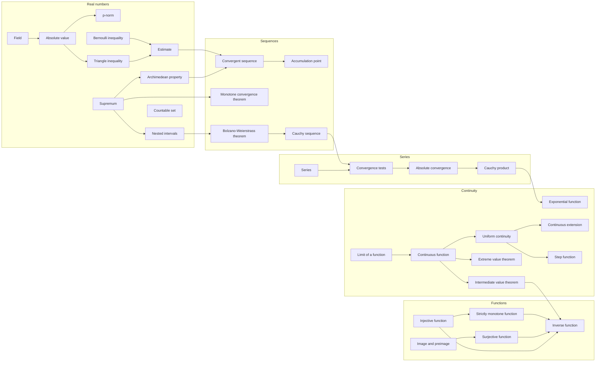
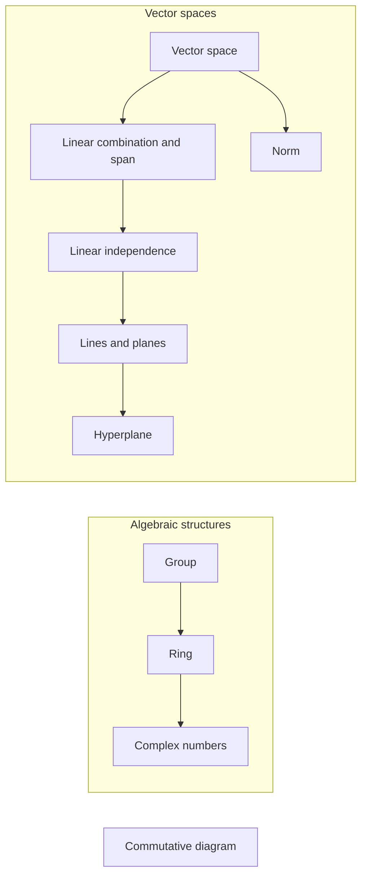
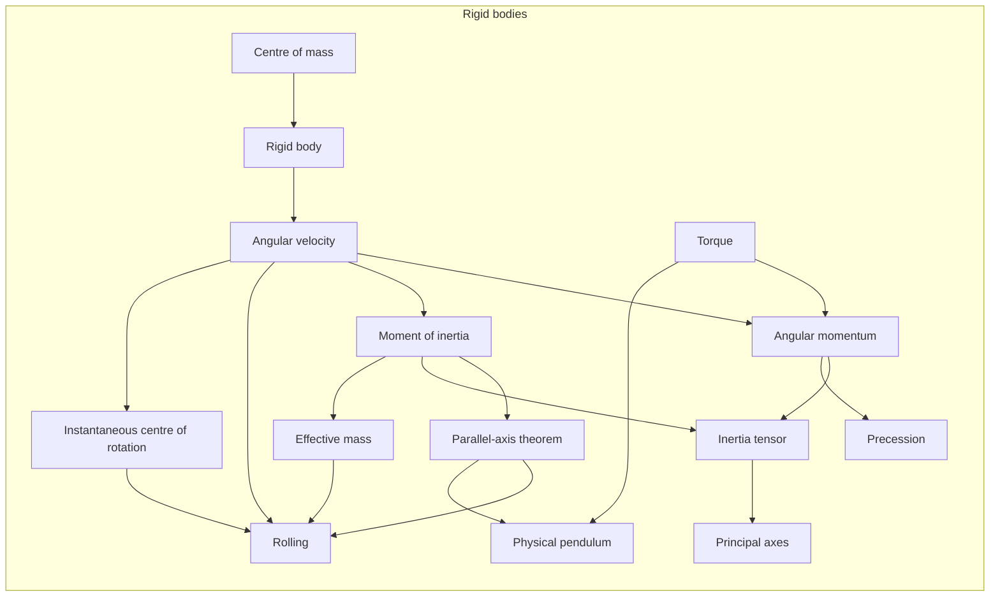
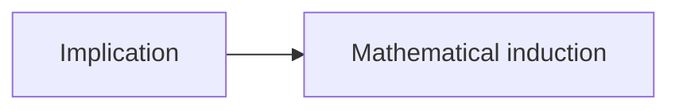

# Atlas

The map of everything learned. Kael'thos keeps it current (`/atlas`); it is mirrored into the
vault as `Atlas.md`.

Levels: **0** unseen · **1** met · **2** understood · **3** retrieved · **4** owned.
`Next` is the next review date. The rules are in `system/method.md`.

## The Dozen

Twelve open questions you carry around (Feynman's habit, via Rota). Every new theorem or trick
gets tested against them.

*Not chosen yet. Kael'thos asks in the first session.*

## Due

| What | When |
|---|---|
| Grimoire re-attempts: 7 entries from ANA UE01 | 2026-10-15 |
| Debrief variants: ANA UE01, 8 problems (`Debriefs/analysis/2026-10-12-ue01.pdf`, last pages) | 2026-10-19 |
| First review of the 10 concepts met in ANA UE01 | 2026-10-19 |
| LA MC drill (`la-mc-prep.pdf`): Part I cold, then again two days before the test | now |
| First review of the 14 rigid-body concepts (EP1, folios physics 01 and 02) | 2026-11-16 |
| First review of the 10 LA concepts (test pool) | 2026-11-17 |
| ANA Übungstest: work the 14-day plan of folio 01 (Part X); Day 10 is a timed mock via `/exam` | daily from 2026-11-22 |
| Folio 02 (Bigger and Simpler): read it with Day 1 of the plan; tasks T01–T17 spread over Days 2–4 | 2026-11-22 |
| First review of the 22 concepts met in folio 01 (Sixteen Moves) and the 2 of folio 02 | 2026-11-28 |

## Analysis

Analysis 1 (ANA) · Cummings, *Real Analysis*. Übungstest (open questions) on Skript ch. 1–4: the playbook is
[[01-sixteen-moves.pdf]]; its estimate toolbox, taken apart tool by tool, is [[02-bigger-and-simpler.pdf]].

| Concept | Level | Next | Folio | Last evidence |
|---|---|---|---|---|
| [[Field]] | 1 | 2026-10-19 | [[01-sixteen-moves.pdf]] | 2026-10-12 ANA UE01/1: checked $\mathbb{Z}_2$, one case argued by an instance |
| [[Absolute value]] | 1 | 2026-10-19 | [[01-sixteen-moves.pdf]], [[02-bigger-and-simpler.pdf]] | 2026-10-12 ANA UE01/2: (a) clean, (b) key step unproved |
| [[p-norm]] | 1 | 2026-10-19 | | 2026-10-12 ANA UE01/3: sets right, inclusions from the sketch |
| [[Image and preimage]] | 1 | 2026-10-19 | [[01-sixteen-moves.pdf]] | 2026-10-12 ANA UE01/4: all eight right; arrows in (a) mistyped |
| [[Injective function]] | 1 | 2026-10-19 | [[01-sixteen-moves.pdf]] | 2026-10-12 ANA UE01/5: all verdicts right |
| [[Surjective function]] | 1 | 2026-10-19 | [[01-sixteen-moves.pdf]] | 2026-10-12 ANA UE01/5: verdicts right; reversed inequality in 5c |
| [[Inverse function]] | 1 | 2026-10-19 | [[01-sixteen-moves.pdf]] | 2026-10-12 ANA UE01/5b: $f_2^{-1}=f_2$, with $f^{-1}\neq 1/f$ noted |
| [[Strictly monotone function]] | 1 | 2026-10-19 | [[01-sixteen-moves.pdf]] | 2026-10-12 ANA UE01/6: right structure, wrong reason cited |
| [[Bernoulli inequality]] | 1 | 2026-11-28 | [[01-sixteen-moves.pdf]], [[02-bigger-and-simpler.pdf]] | 2026-11-21 folio 01; used in UE02/1 |
| [[Triangle inequality]] | 1 | 2026-11-28 | [[02-bigger-and-simpler.pdf]] | 2026-11-21 folio 02, Tools 01–02; asked what "a difference must be split" means |
| [[Estimate]] | 1 | 2026-11-28 | [[02-bigger-and-simpler.pdf]] | 2026-11-21 folio 02, keystone; asked why a minus sign in a denominator matters |
| [[Supremum]] | 1 | 2026-11-28 | [[01-sixteen-moves.pdf]] | 2026-11-21 folio 01, Move 02 and keystone |
| [[Archimedean property]] | 1 | 2026-11-28 | [[01-sixteen-moves.pdf]] | 2026-11-21 folio 01; cited in UE02/3 |
| [[Nested intervals]] | 1 | 2026-11-28 | [[01-sixteen-moves.pdf]] | 2026-11-21 folio 01 |
| [[Countable set]] | 1 | 2026-11-28 | [[01-sixteen-moves.pdf]] | 2026-11-21 folio 01, Part VII |
| [[Convergent sequence]] | 1 | 2026-11-28 | [[01-sixteen-moves.pdf]] | 2026-11-21 folio 01, Move 04; UE03 used limit laws where the definition was asked |
| [[Accumulation point]] | 1 | 2026-11-28 | [[01-sixteen-moves.pdf]] | 2026-11-21 folio 01, Move 05 |
| [[Monotone convergence theorem]] | 1 | 2026-11-28 | [[01-sixteen-moves.pdf]] | 2026-11-21 folio 01, Move 06; UE03/7 Heron solved |
| [[Bolzano-Weierstrass theorem]] | 1 | 2026-11-28 | [[01-sixteen-moves.pdf]] | 2026-11-21 folio 01, Part VII |
| [[Cauchy sequence]] | 1 | 2026-11-28 | [[01-sixteen-moves.pdf]] | 2026-11-21 folio 01, Move 06 |
| [[Series]] | 1 | 2026-11-28 | [[01-sixteen-moves.pdf]] | 2026-11-21 folio 01, Move 07; UE03/3b telescope solved |
| [[Convergence tests]] | 1 | 2026-11-28 | [[01-sixteen-moves.pdf]] | 2026-11-21 folio 01, Move 08; UE04 used $(1-\frac1k)^k\to\frac1e$, not in the Skript |
| [[Absolute convergence]] | 1 | 2026-11-28 | [[01-sixteen-moves.pdf]] | 2026-11-21 folio 01, Move 09; UE04/5b Leibniz monotonicity asserted, not shown |
| [[Cauchy product]] | 1 | 2026-11-28 | [[01-sixteen-moves.pdf]] | 2026-11-21 folio 01; UE05/0 solved |
| [[Exponential function]] | 1 | 2026-11-28 | [[01-sixteen-moves.pdf]] | 2026-11-21 folio 01, Move 10 |
| [[Limit of a function]] | 1 | 2026-11-28 | [[01-sixteen-moves.pdf]] | 2026-11-21 folio 01, Moves 11–12; UE05/1–2 solved |
| [[Continuous function]] | 1 | 2026-11-28 | [[01-sixteen-moves.pdf]] | 2026-11-21 folio 01, Moves 11, 13; UE05/3a $\delta$ found |
| [[Intermediate value theorem]] | 1 | 2026-11-28 | [[01-sixteen-moves.pdf]] | 2026-11-21 folio 01, Move 14; UE05/5a, 5/7 solved |
| [[Extreme value theorem]] | 1 | 2026-11-28 | [[01-sixteen-moves.pdf]] | 2026-11-21 folio 01, Part VII |
| [[Uniform continuity]] | 1 | 2026-11-28 | [[01-sixteen-moves.pdf]] | 2026-11-21 folio 01, Move 15; UE05/3b solved |
| [[Continuous extension]] | 1 | 2026-11-28 | [[01-sixteen-moves.pdf]] | 2026-11-21 folio 01; UE05/5b, 8b solved |
| [[Step function]] | 1 | 2026-11-28 | [[01-sixteen-moves.pdf]] | 2026-11-21 folio 01, Part VII |

Homework solved on paper counts as "met". Level 2 needs a teach-back or a clean self-explanation.

## Linear algebra

Lineare Algebra 1 (LA). Multiple-choice test from a 27-question pool; drill:
[[la-mc-prep.pdf]] (`Exams/linear-algebra/`). Maps (injective, surjective) and fields are
mapped under Analysis.

| Concept | Level | Next | Folio | Last evidence |
|---|---|---|---|---|
| [[Commutative diagram]] | 1 | 2026-11-17 | | 2026-11-10 LA pool Q8; drill not taken yet |
| [[Group]] | 1 | 2026-11-17 | | 2026-11-10 LA pool Q9, Q10; drill not taken yet |
| [[Ring]] | 1 | 2026-11-17 | | 2026-11-10 LA pool Q12; drill not taken yet |
| [[Complex numbers]] | 1 | 2026-11-17 | | 2026-11-10 LA pool Q19; drill not taken yet |
| [[Vector space]] | 1 | 2026-11-17 | | 2026-11-10 LA pool Q25; drill not taken yet |
| [[Linear combination and span]] | 1 | 2026-11-17 | | 2026-11-10 LA pool Q26; drill not taken yet |
| [[Linear independence]] | 1 | 2026-11-17 | | 2026-11-10 LA pool Q13, Q14, Q18, Q20 to Q22, Q27; drill not taken yet |
| [[Lines and planes]] | 1 | 2026-11-17 | | 2026-11-10 LA pool Q15, Q16; drill not taken yet |
| [[Hyperplane]] | 1 | 2026-11-17 | | 2026-11-10 LA pool Q17, Q23; drill not taken yet |
| [[Norm]] | 1 | 2026-11-17 | | 2026-11-10 LA pool Q24; drill not taken yet |

## Physics

Experimentalphysik 1 (EP1).

| Concept | Level | Next | Folio | Last evidence |
|---|---|---|---|---|
| [[Rigid body]] | 1 | 2026-11-16 | [[01-starrer-koerper.pdf]] | 2026-11-09 EP1 notes + folio 01 |
| [[Angular velocity]] | 1 | 2026-11-16 | [[01-starrer-koerper.pdf]] | 2026-11-09 EP1 notes: $\vec v_i = \vec v_s+\vec\omega\times\vec r_{si}$ written down |
| [[Centre of mass]] | 1 | 2026-11-16 | [[01-starrer-koerper.pdf]] · [[02-drehen-im-bild.pdf]] | 2026-11-09 EP1 notes: gravity torque $= M\vec R_s\times\vec g$, stability stated |
| [[Torque]] | 1 | 2026-11-16 | [[01-starrer-koerper.pdf]] | 2026-11-09 EP1 notes + folio 01 |
| [[Moment of inertia]] | 1 | 2026-11-16 | [[01-starrer-koerper.pdf]] | 2026-11-09 EP1 notes: cylinder $I_{zz} = \frac12MR^2$ computed |
| [[Parallel-axis theorem]] | 1 | 2026-11-16 | [[01-starrer-koerper.pdf]] | 2026-11-09 folio 01 |
| [[Angular momentum]] | 1 | 2026-11-16 | [[01-starrer-koerper.pdf]] | 2026-11-09 EP1 notes + folio 01 |
| [[Inertia tensor]] | 1 | 2026-11-16 | [[01-starrer-koerper.pdf]] | 2026-11-09 EP1 notes: derived; sign slip in $L_1$ (fixed in folio) |
| [[Principal axes]] | 1 | 2026-11-16 | [[01-starrer-koerper.pdf]] | 2026-11-09 folio 01 |
| [[Rolling]] | 1 | 2026-11-16 | [[01-starrer-koerper.pdf]] | 2026-11-09 folio 01 + video |
| [[Physical pendulum]] | 1 | 2026-11-16 | [[01-starrer-koerper.pdf]] | 2026-11-09 folio 01 |
| [[Precession]] | 1 | 2026-11-16 | [[01-starrer-koerper.pdf]] | 2026-11-09 folio 01 |
| [[Instantaneous centre of rotation]] | 1 | 2026-11-16 | [[02-drehen-im-bild.pdf]] | 2026-11-09 folio 02 |
| [[Effective mass]] | 1 | 2026-11-16 | [[02-drehen-im-bild.pdf]] | 2026-11-09 folio 02 |

## Methods

Physikalische Rechenmethoden (RM).

*No concepts yet.*

## Proofs

Udemy proofs course (PRF), and the proofs met in analysis and linear algebra.

| Concept | Level | Next | Folio | Last evidence |
|---|---|---|---|---|
| [[Implication]] | 1 | 2026-10-19 | | 2026-10-12 ANA UE01/7: $A\Rightarrow B$ right; converse refuted with part of $A$ |
| [[Mathematical induction]] | 1 | 2026-10-19 | [[01-sixteen-moves.pdf]] | 2026-10-12 ANA UE01/8: correct; step opened with the goal |

## ODEs

Udemy differential equations course (ODE).

*No concepts yet.*
