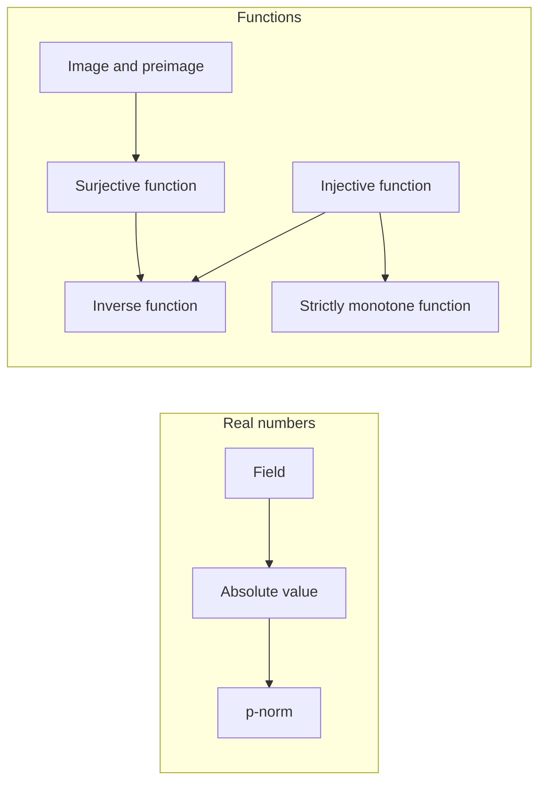
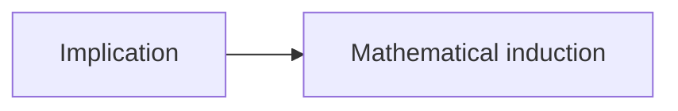

# Atlas

The map of everything learned. Kael'thos keeps it current (`/atlas`); it is mirrored into the
vault as `Atlas.md`.

Levels: **0** unseen · **1** met · **2** understood · **3** retrieved · **4** owned.
`Next` is the next review date. The rules are in `system/method.md`.

## The Dozen

Twelve open questions you carry around (Feynman's habit, via Rota). Every new theorem or trick
gets tested against them.

*Not chosen yet. Kael'thos asks in the first session.*

## Due

| What | When |
|---|---|
| Grimoire re-attempts: 7 entries from ANA UE01 | 2026-10-15 |
| Debrief variants: ANA UE01, 8 problems (`Debriefs/analysis/2026-10-12-ue01.pdf`, last pages) | 2026-10-19 |
| First review of the 10 concepts met in ANA UE01 | 2026-10-19 |

## Analysis

Analysis 1 (ANA) · Cummings, *Real Analysis*.

| Concept | Level | Next | Folio | Last evidence |
|---|---|---|---|---|
| [[Field]] | 1 | 2026-10-19 | | 2026-10-12 ANA UE01/1: checked $\mathbb{Z}_2$, one case argued by an instance |
| [[Absolute value]] | 1 | 2026-10-19 | | 2026-10-12 ANA UE01/2: (a) clean, (b) key step unproved |
| [[p-norm]] | 1 | 2026-10-19 | | 2026-10-12 ANA UE01/3: sets right, inclusions from the sketch |
| [[Image and preimage]] | 1 | 2026-10-19 | | 2026-10-12 ANA UE01/4: all eight right; arrows in (a) mistyped |
| [[Injective function]] | 1 | 2026-10-19 | | 2026-10-12 ANA UE01/5: all verdicts right |
| [[Surjective function]] | 1 | 2026-10-19 | | 2026-10-12 ANA UE01/5: verdicts right; reversed inequality in 5c |
| [[Inverse function]] | 1 | 2026-10-19 | | 2026-10-12 ANA UE01/5b: $f_2^{-1}=f_2$, with $f^{-1}
eq 1/f$ noted |
| [[Strictly monotone function]] | 1 | 2026-10-19 | | 2026-10-12 ANA UE01/6: right structure, wrong reason cited |

Homework solved on paper counts as "met". Level 2 needs a teach-back or a clean self-explanation.

## Linear algebra

Lineare Algebra 1 (LA).

*No concepts yet.*

## Physics

Experimentalphysik 1 (EP1).

*No concepts yet.*

## Methods

Physikalische Rechenmethoden (RM).

*No concepts yet.*

## Proofs

Udemy proofs course (PRF), and the proofs met in analysis and linear algebra.

| Concept | Level | Next | Folio | Last evidence |
|---|---|---|---|---|
| [[Implication]] | 1 | 2026-10-19 | | 2026-10-12 ANA UE01/7: $A\Rightarrow B$ right; converse refuted with part of $A$ |
| [[Mathematical induction]] | 1 | 2026-10-19 | | 2026-10-12 ANA UE01/8: correct; step opened with the goal |

## ODEs

Udemy differential equations course (ODE).

*No concepts yet.*
